<div align="center">


<a href="https://www.linkedin.com/in/alex-jsz/"></a>&nbsp;<a href="https://alexjsz.vercel.app/"></a>&nbsp;<a href="mailto:benalex511@gmail.com"></a>

</div>

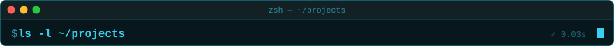

<p align="center"></p>

<p align="center"><a href="https://github.com/alexzjss/clawdesk">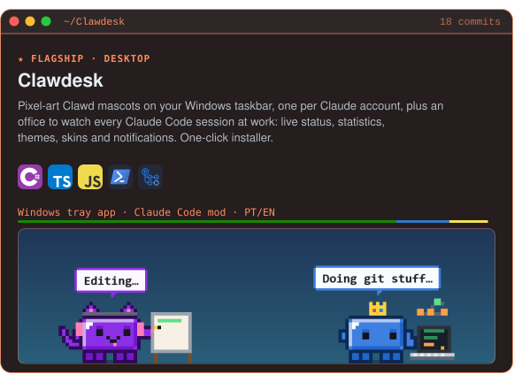</a><a href="https://github.com/alexzjss/virtualJRPG">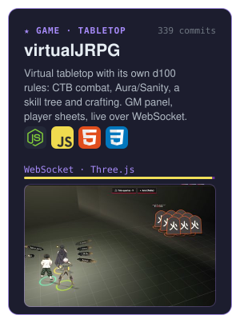</a></p>

<p align="center"><a href="https://github.com/alexzjss/dasiboard-omg">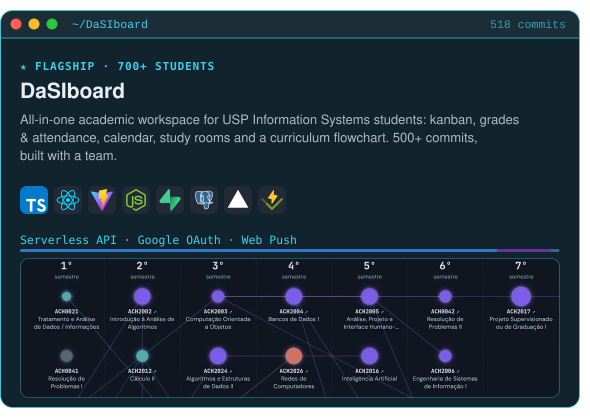</a><a href="https://github.com/alexzjss/SampaNav">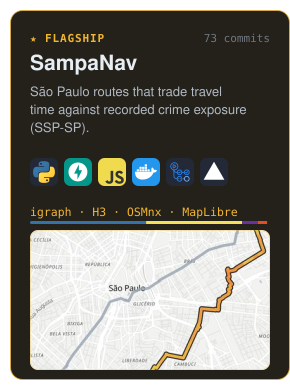</a></p>

<p align="center"><a href="https://github.com/alexzjss/constela">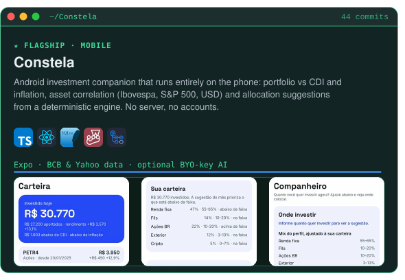</a><a href="https://github.com/alexzjss/acha-promocoes">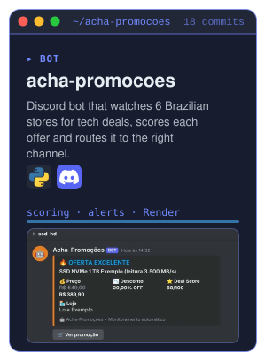</a></p>

<p align="center"><a href="https://github.com/alexzjss/engrama">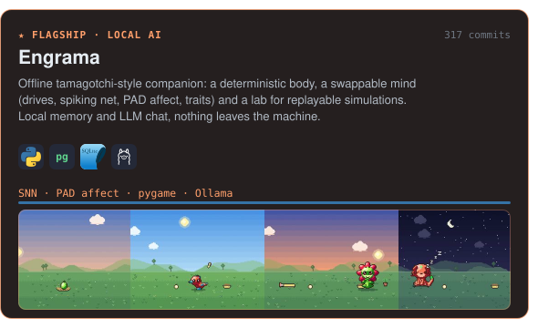</a><a href="https://github.com/alexzjss/jflp">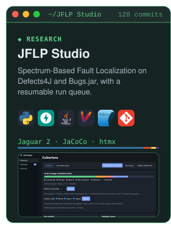</a></p>

<details>
<summary>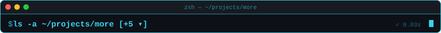</summary>
<br>

<p align="center"><a href="https://github.com/alexzjss/modaloop">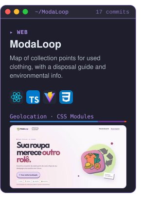</a><a href="https://github.com/alexzjss/vat">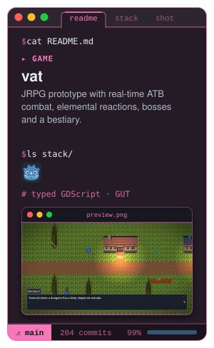</a><a href="https://github.com/alexzjss/ICNDY">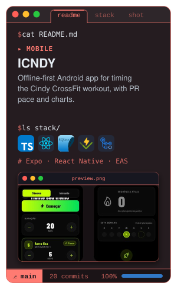</a></p>

<p align="center"><a href="https://github.com/alexzjss/website">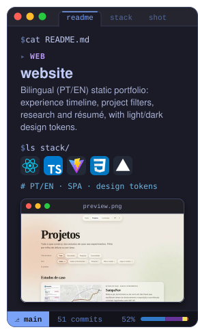</a><a href="https://github.com/alexzjss/eco-fruta">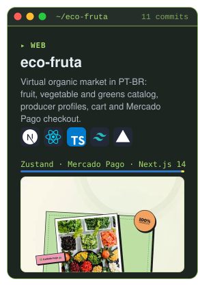</a></p>

</details>

<p align="center"><sub>live: <a href="https://dasiboard.vercel.app/">DaSIboard</a> · <a href="https://sampanav.vercel.app">SampaNav</a> · <a href="https://alexjsz.vercel.app/">website</a> · <a href="https://eco-fruta.vercel.app">eco-fruta</a> · <a href="https://github.com/alexzjss/clawdesk/releases/latest">Clawdesk (installer)</a> · <a href="https://github.com/alexzjss/constela/releases/latest">Constela (APK)</a> · <a href="https://github.com/alexzjss?tab=repositories">all repos</a></sub></p>


```diff
+ [SAEG · PUB/USP]  Data Generation for Software Testing & Debugging Experimentation
```

- `project ` [Data Generation for Software Testing & Debugging Experimentation](https://uspdigital.usp.br/jupiterweb/beneficioBolsaUnificadaListar?codmnu=6684#) · unified scholarship (PUB/USP) · **current**
- `group   ` Software Analysis & Experimentation Group (SAEG), advised by **Prof. Dr. Marcos Lordello Chaim**
- `dataset ` [**Bugs.jar**](https://github.com/bugs-dot-jar/bugs-dot-jar): real bugs from large Apache Java projects (Accumulo, Camel, Commons Math, Flink, Jackrabbit Oak, Log4j 2, Maven, Wicket)
- `method  ` line and control-flow coverage with **Jaguar 2**, running each faulty version's tests on Linux with Java/Maven
- `goal    ` coverage data for testing and debugging experiments (e.g. spectrum-based fault localization), shared with the research community

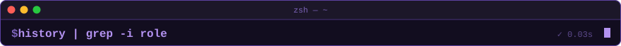

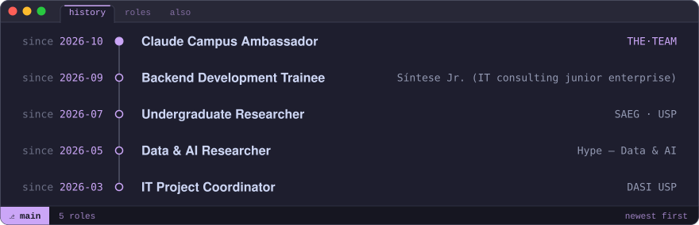

<sub>also: PET-SI EACH-USP (scholar) · Each In The Shell (cybersecurity) · USPCodeLab Leste (web PM) · Conway USP (gamedev, design lead) · Semana de SI (organizing committee)</sub>


<table width="100%">
<tr>
<td align="center" width="40%">
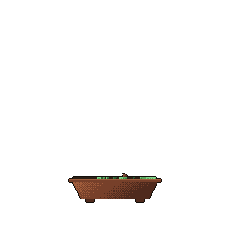
<br><sub>grown daily from my commits</sub>
</td>
<td width="60%">
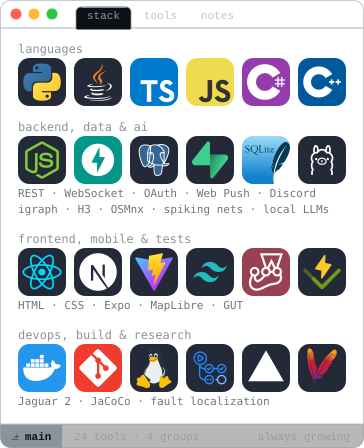
</td>
</tr>
</table>

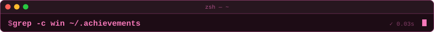

<p align="center"><a href="https://www.instagram.com/uspcodelab/">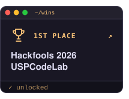</a><a href="https://www.instagram.com/p/DYkP8RnkaMo/?img_index=5">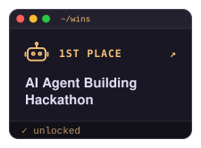</a><a href="https://www.instagram.com/p/DcwirCMmOkN/?img_index=2">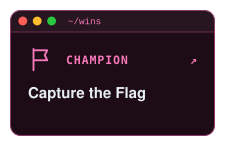</a><a href="https://premiacao.obmep.org.br/20obmep/verRelatorioPremiadosEstadualPorNivel-BA.3.do.htm">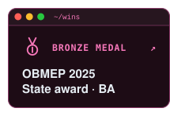</a></p>

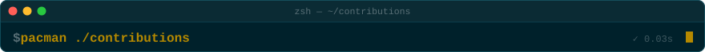


<div align="center">
<br>
<sub><code>$ exit</code></sub>
<br><br>
<a href="https://www.linkedin.com/in/alex-jsz/"></a>&nbsp;<a href="https://alexjsz.vercel.app/"></a>&nbsp;<a href="mailto:benalex511@gmail.com"></a>
</div>
