<div align="center">

<picture>
  <source media="(prefers-color-scheme: dark)" srcset="assets/header-dark.svg">
  
</picture>

[](https://www.linkedin.com/in/alex-jsz/) [](https://alexjsz.vercel.app/) [](mailto:benalex511@gmail.com)

</div>

### `$ cat about.md`

Information Systems undergrad at the **University of São Paulo**, working where **software engineering meets data**.
I build backend systems and full-stack products that people actually use, and I do research on **software testing & debugging**.
I spend the rest of my time on ML/AI, security CTFs and game systems.

### `$ ls -l ~/projects`

| | Project | What it is | Stack |
|:-:|---|---|---|
| ★ | **[DaSIboard](https://github.com/alexzjss/dasiboard-omg)** · [live](https://dasiboard.vercel.app/) | All-in-one academic workspace for USP Information Systems students: kanban, grades & attendance, calendar, study rooms, curriculum flowchart. **700+ students**, 500+ commits, built with a team. | TypeScript · React · Supabase/Postgres · Vercel |
| ★ | **[RPG Codex VTT](https://github.com/alexzjss/vttrpg)** · [live](https://vat-gules.vercel.app) | Virtual tabletop with tactical scenes, turn-based combat, a visual ability-graph editor with simulation, offline-first storage and versioned online campaign sync with GM review. | TypeScript · React · Supabase · IndexedDB |
| ◆ | **[JFLP Studio](https://github.com/alexzjss/jflp)** | Experimental framework for **Spectrum-Based Fault Localization**: drives Maven + Jaguar 2 over Defects4J / Bugs.jar with a resumable run queue, immutable runs and dataset export. | Python · Maven · Jaguar 2 |
| ◆ | **TrendSurfer** · <sub>private</sub> | Itaú Quant AI Challenge, team of 3: long/short momentum strategy on the IBOV universe, with a point-in-time universe, corporate-action adjustments and no look-ahead or survivorship bias. | Python · Polars · DuckDB · Streamlit |
| ▸ | **[vat](https://github.com/alexzjss/vat)** | JRPG prototype with real-time ATB combat, elemental reactions, status effects, dungeons, bosses and a bestiary, in typed GDScript. | Godot 4 · GDScript |
| ▸ | **[ICNDY](https://github.com/alexzjss/ICNDY)** | Offline-first Android app for timing the *Cindy* CrossFit workout: tap-to-count rounds, PR pace, progress charts. | TypeScript · React Native · Expo |

<sub>★ flagship &nbsp;·&nbsp; ◆ research & data &nbsp;·&nbsp; ▸ side builds</sub>

### `$ cat research.log`

```diff
+ [SAEG · PUB/USP]  Data Generation for Software Testing & Debugging Experimentation
```

Undergraduate research with the **Software Analysis & Experimentation Group**, advised by **Prof. Dr. Marcos Lordello Chaim**.
I collect control-flow coverage with **Jaguar 2** on the **Defects4J** benchmark (875 real faulty versions from 17 projects) to generate data for fault-localization experiments.
That work runs on large-scale Java/Maven test execution, automated in [JFLP Studio](https://github.com/alexzjss/jflp).

### `$ history | grep -i role`

| Since | Role | Where |
|---|---|---|
| `2026-10` | Claude Campus Ambassador | THE·TEAM |
| `2026-09` | Backend Development Trainee | Síntese Jr. *(IT consulting junior enterprise)* |
| `2026-07` | Undergraduate Researcher | SAEG · USP |
| `2026-05` | Data & AI Researcher | Hype — Data & AI |
| `2026-03` | IT Project Coordinator | DASI USP |

<sub>also: PET-SI EACH-USP (scholar) · Each In The Shell (cybersecurity) · USPCodeLab Leste (web PM) · Conway USP (gamedev, design lead) · Semana de SI (organizing committee)</sub>

### `$ tree --grow ~/stack`

<table>
<tr>
<td align="center" width="45%">

<br><sub>grown daily from my commits</sub>
</td>
<td align="center" width="55%">

</td>
</tr>
</table>

### `$ grep -c win ~/.achievements`

🏆 Hackfools 2026 champion &nbsp;·&nbsp; 🤖 1st place, AI Agent Building Hackathon &nbsp;·&nbsp; 🚩 CTF champion &nbsp;·&nbsp; 🥉 OBMEP bronze medal

<div align="center">
<br>
<sub><code>$ exit</code> &nbsp;—&nbsp; <a href="https://www.linkedin.com/in/alex-jsz/">linkedin</a> · <a href="https://alexjsz.vercel.app/">portfolio</a> · <a href="mailto:benalex511@gmail.com">email</a></sub>
</div>
