<div align="center">


<a href="https://www.linkedin.com/in/alex-jsz/"></a>&nbsp;<a href="https://alexjsz.vercel.app/"></a>&nbsp;<a href="mailto:benalex511@gmail.com"></a>

</div>


Information Systems undergrad at the **University of São Paulo**.

- `focus   ` **software engineering meets data**: backend systems and full-stack products people actually use
- `built   ` academic tooling for **700+ students** · a safety-aware route planner for **São Paulo**
- `research` **software testing & debugging**
- `also    ` geospatial data · ML/AI · security CTFs · game systems


<p align="center"></p>

<p align="center"><a href="https://github.com/alexzjss/dasiboard-omg">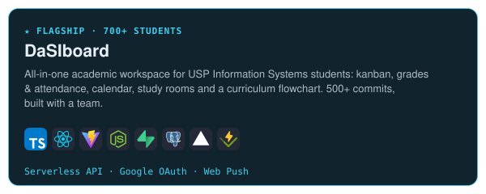</a><a href="https://github.com/alexzjss/SampaNav">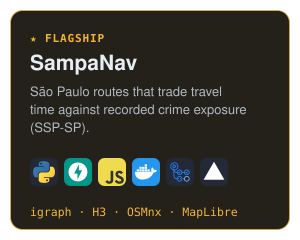</a></p>

<p align="center"><a href="https://github.com/alexzjss/jflp">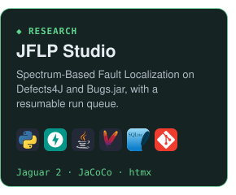</a><a href="https://github.com/alexzjss/modaloop">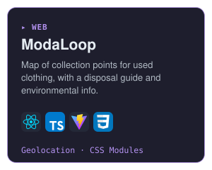</a><a href="https://github.com/alexzjss/vat">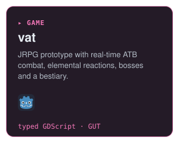</a></p>

<p align="center"><a href="https://github.com/alexzjss/ICNDY">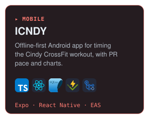</a><a href="https://github.com/alexzjss/website">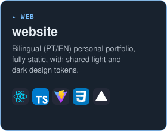</a><a href="https://github.com/alexzjss/eco-fruta">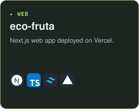</a></p>

<p align="center"><sub>live: <a href="https://dasiboard.vercel.app/">DaSIboard</a> · <a href="https://sampanav.vercel.app">SampaNav</a> · <a href="https://alexzjss.github.io/website/">website</a> · <a href="https://eco-fruta.vercel.app">eco-fruta</a></sub></p>


```diff
+ [SAEG · PUB/USP]  Data Generation for Software Testing & Debugging Experimentation
```

- `group   ` Software Analysis & Experimentation Group (SAEG), advised by **Prof. Dr. Marcos Lordello Chaim**
- `method  ` control-flow coverage with **Jaguar 2** on the **Defects4J** benchmark
- `scale   ` 875 real faulty versions from 17 projects, via large-scale Java/Maven test execution
- `goal    ` data for fault-localization experiments, automated in [JFLP Studio](https://github.com/alexzjss/jflp)


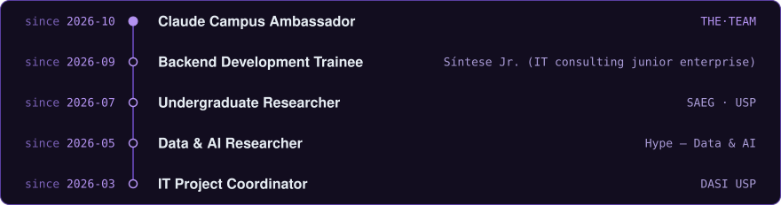

<sub>also: PET-SI EACH-USP (scholar) · Each In The Shell (cybersecurity) · USPCodeLab Leste (web PM) · Conway USP (gamedev, design lead) · Semana de SI (organizing committee)</sub>


<table>
<tr>
<td align="center" width="40%">
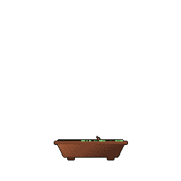
<br><sub>grown daily from my commits</sub>
</td>
<td width="60%">
<sub><code>languages</code></sub><br>
<br>
<sub><code>frontend</code></sub><br>
<br>
<sub><code>backend &amp; data</code></sub><br>
<br>
<sub><code>tools</code></sub><br>

</td>
</tr>
</table>


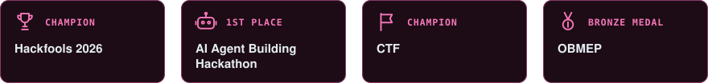


<div align="center">
<br>
<sub><code>$ exit</code> &nbsp;—&nbsp; <a href="https://www.linkedin.com/in/alex-jsz/">linkedin</a> · <a href="https://alexjsz.vercel.app/">portfolio</a> · <a href="mailto:benalex511@gmail.com">email</a></sub>
</div>
